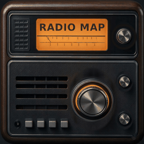
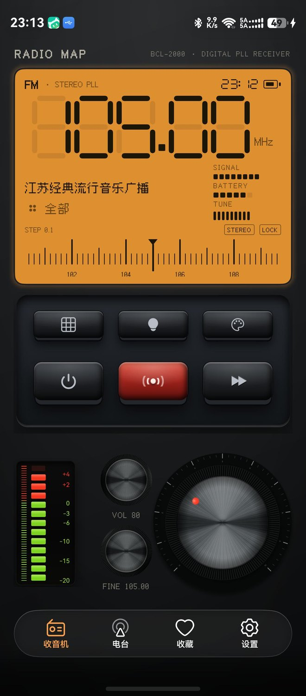
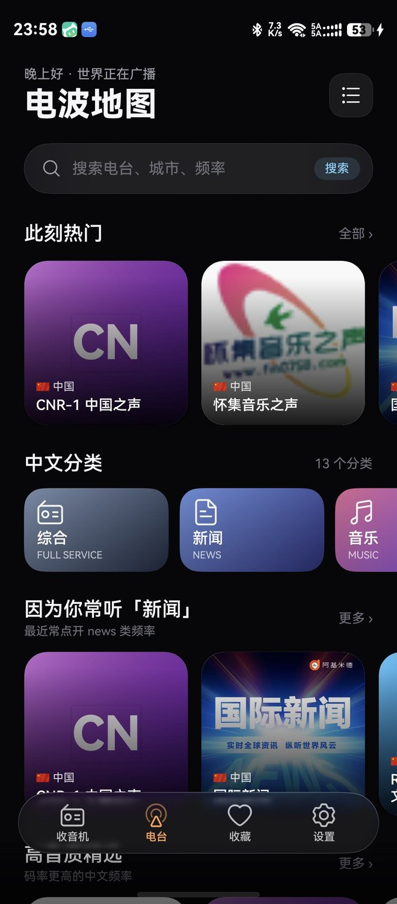
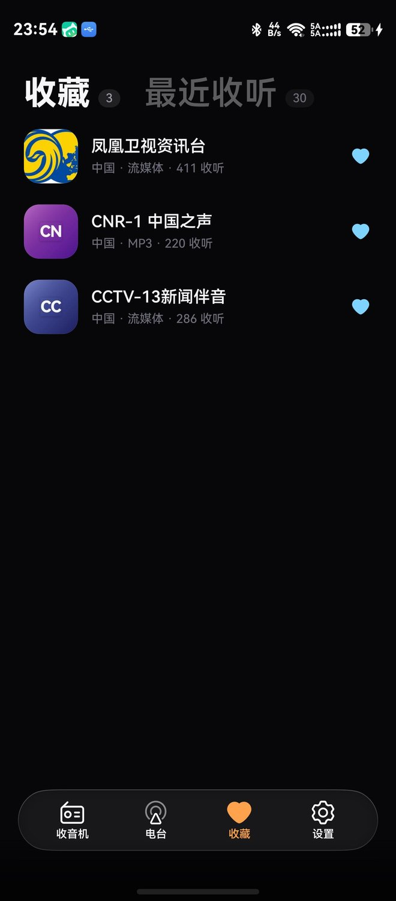
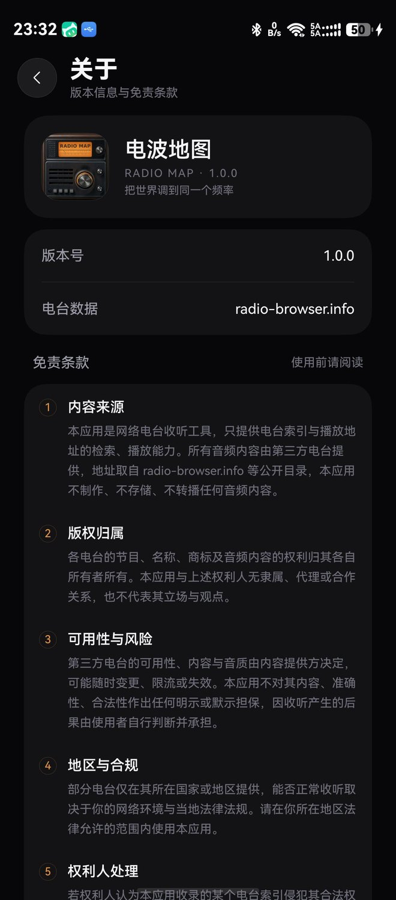

# 电波地图 · Radio Map

<p align="center">
  
</p>

<p align="center">
  <b>HarmonyOS NEXT 原生网络电台</b><br>
  <sub>复古指针收音机面板 · 七段数码 LCD · 本地电台目录 · 旋钮光效</sub>
</p>

<p align="center">
  
  
  
  
  
  
</p>

---

## ⬇️ 下载

> **本仓库不包含源代码，仅发布未签名的安装包（.hap）。**

| 版本 | 安装包 | 大小 | 平台要求 | 下载 |
| :--- | :--- | :--- | :--- | :--- |
| **v1.0.0** | `radio-map-1.0.0-unsigned.hap` | 7.3 MB | HarmonyOS NEXT 26.0.0 (API 26) / arm64 | [前往 Releases 下载](https://github.com/docomola/radio-map/releases/latest) |

---

## 🔏 关于「未签名」

> ⚠️ **发布包为未签名包（unsigned），不能直接 `hdc install`。** 上机前必须先用自己的证书与 Profile 重签一次。
> 这样做的原因是：签名必须绑定「设备 UDID + 应用身份」，任何第三方签好的包都只能装回签名者自己的设备，未签名包反而更通用 —— 谁签谁的设备就能装。

### 重签步骤

```bash
# 1. 准备材料（DevEco Studio → 自动签名可自动落在 ~/.ohos/config/）
#    .p12 密钥库 / .cer 证书 / .p7b Profile（Profile 需绑定 bundleName: com.verlin.lumina，
#    且目标设备的 UDID 在 Profile 设备列表中）

# 2. 用 SDK 自带的 hap-sign-tool 重签
java -jar "$DEVECO_SDK_HOME/default/openharmony/toolchains/lib/hap-sign-tool.jar" sign-app \
  -mode localSign -signAlg SHA256withECDSA \
  -keyAlias "debugKey" \
  -keystoreFile "your.p12"  -keystorePwd "******" \
  -appCertFile  "your.cer" \
  -profileFile  "your.p7b" \
  -inFile  "radio-map-1.0.0-unsigned.hap" \
  -outFile "radio-map-1.0.0-signed.hap"

# 3. 安装
hdc list targets                      # 确认设备已识别
hdc install -r radio-map-1.0.0-signed.hap
```

> 若安装报 `9568289` / `9568320`，说明证书 / Profile / 设备 UDID 三者不匹配，重新做一次自动签名即可。
> 手机需在「设置 → 关于本机」连点版本号开启开发者模式，并打开「开发者选项 → USB 调试」。

---

## ✨ 功能特性

| 模块 | 说明 |
| :--- | :--- |
| **复古面板** | 橙色背光 LCD + 七段数码管显示频率与台名，信号 / 电量 / TUNE 小格，底部条状刻度盘随频率滑动 |
| **大旋钮** | Canvas 自绘滚花金属盘，拖动即调频；转动时内外圈之间的槽内亮起橘红渐变光，松手熄灭 |
| **双小旋钮** | 左侧 VOL 控音量、右侧 FINE 做微调，同款滚花质感、无外圈刻度 |
| **VU 电平表** | 单通道 13 段 LED + dB 刻度，静默时刻度与数字皆为灰，有声时随电平由绿转红点亮 |
| **分类切台** | 全部 / 综合 / 新闻 / 音乐 / 交通 / 影视 / 生活 / 财经 / 民族 / 文化 / 戏曲 / 乡村 / 少儿 / 体育 共 14 类，图标取自鸿蒙官方符号体系 |
| **随机起播** | 切换分类立刻从该分类里随机挑一个台起播，不经过列表 |
| **本地目录** | 「全部电台」整包拉到本机落盘（中国区约 1900 条 / 全球约 1500 条），二次打开毫秒级出屏；排序、编码、码率筛选全在内存完成，滑动零请求 |
| **收藏与最近收听** | 两个平级列表，点击即播，右侧心形直接收藏 / 取消；收听记录自动留存 |
| **播放稳定性** | 直播流 reset 超时自愈、14 秒起播看门狗自动跳台、失效台拉黑；支持后台播放与锁屏控制 |
| **外观设置** | 屏幕配色与背光亮度可调，设置页含关于与免责条款 |
| **悬浮玻璃底栏** | 四个页签，未选中 70% 透明、选中 100% 并换强调色 |

<p align="center">
  
  
</p>
<p align="center">
  
  
</p>

---

## 📱 运行环境

| 项目 | 要求 |
| :--- | :--- |
| 系统 | HarmonyOS NEXT 26.0.0（API 26）及以上 |
| 架构 | arm64-v8a |
| 设备 | 手机 |
| 网络 | 首次启动需联网读取电台目录 |
| 数据源 | [radio-browser.info](https://www.radio-browser.info/) 公开电台索引 |
| 应用标识 | `com.verlin.lumina` |

---

## 📄 免责声明

1. **内容来源**：本应用仅做电台索引与播放地址检索，不制作、不存储、不转播任何音频内容。
2. **版权归属**：所有电台内容版权归各自权利人所有，本应用与任何电台无隶属或合作关系。
3. **可用性与风险**：第三方电台随时可能变更或失效，本应用不对其可用性作任何担保。
4. **地区与合规**：能否收听取决于所在网络与当地法规，请自行判断并遵守当地法律。
5. **权利人处理**：若权利人认为存在侵权，可通过 Issue 联系，核实后立即下架相关索引。
6. **隐私说明**：不收集个人身份信息、不申请敏感权限，收藏与收听记录仅保存在本机。
7. **条款更新**：本声明可能随版本更新调整，继续使用即视为接受更新后的条款。

---

## 📅 版本记录

| 版本 | 日期 | 说明 |
| :--- | :--- | :--- |
| v1.0.0 | 2026-11-23 | 首个公开版本：复古收音机面板、14 分类随机起播、本地电台目录、收藏与最近收听、外观与关于 |

<sub>本仓库仅分发安装包，不提供源代码。应用图标与界面设计版权归作者所有。</sub>
